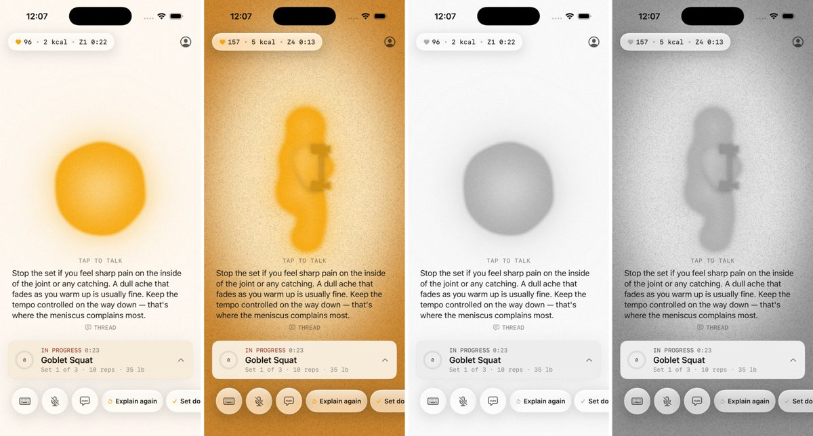

# Workout atmosphere

The workout screen behaves like weather that follows your effort. This builds
"The screen as atmosphere" in `docs/product/ideas.md`.

## Pieces

| What | Where |
| --- | --- |
| Effort, eased over ~10 s | `Features/Coach/Atmosphere/Effort.swift` (`EffortSignal`, `EffortTarget`) |
| Heart rate in, calories, zone time, recovery out | `Atmosphere/WorkoutVitals.swift` |
| The colour + grain pass | `Atmosphere/Atmosphere.metal`, `Atmosphere/WorkoutAtmosphere.swift` |
| Live stats pill | `Atmosphere/LiveStatsPill.swift` |
| MYO mirrors you | `Orb/OrbView.swift` (breath, bounce), `Orb/ExerciseMotion.swift` (`WorkoutLife`: cheer, stretch) |
| Pretend heart rate (DEBUG) | `Atmosphere/HeartRateSimulator.swift`, the **IronBoi Heart** scheme |

`CoachView` hosts all of it (background, top-leading overlay, a 1 Hz task).
`CoachStageView` is unchanged.

## Effort

- **With heart rate** (a reading ≤ 15 s old in `HeartRateHub.latest`, plus an
  age): the share of max HR, with max = 208 − 0.7 × age (`HeartZones.maxHR`,
  the same max the zones use), raised to the session peak if that's higher.
  55% of max reads as 0 (calm) and 90% as 1 (pumping).
- **Without**: the workout's own state. Warming up (no set done yet) 0.35, a
  working set 0.65, rest 0.2. These sit inside the range, not at its ends,
  because state alone can't tell an easy set from a hard one.
- **Easing**: exponential, τ = 10/3 s, so 95% of a change lands in 10 s. It's
  computed on read from elapsed time, so it's smooth at any frame rate.

## Look

At **calm** the paper lifts toward white (or, on Night, lifts a little): the
screen gets brighter and flatter, with almost no colour. Grain is fine
(0.55 pt), sparse (4% of cells) and changes 6 times a second.

At **pumping** there's a warm glow where MYO stands, falling off in a tall oval
to deep coach colour at the edges: darker, with more contrast and more colour.
Grain is coarser (1.1 pt), denser (30%), stronger, and changes 24 times a second.

Every step that adds colour also changes brightness and contrast, and grain
density changes as well, so calm and pumped differ without hue. See
"Greyscale check" below. The glow follows the coach colour you picked.

Under Reduce Motion the grain freezes. The colour still follows effort.

## MYO

Effort is only used mid-workout. Outside a workout MYO's behaviour is
unchanged, and so is `AmbientLife` (the home screen).

- **Calm**: slower, deeper breath; longer pauses between acts; slow stretches
  (arms float overhead, or reach up and lean side to side).
- **Pumped**: quicker, shallower breath with a light bounce as a blob; more
  cheering, with bigger hops; shorter pauses.
- **Neutral (0.5)**: the same mix as before (70% demo, 15% cheer).
- The breath phase now accumulates instead of `sin(time × rate)`, so a
  change of pace (rest starting, effort moving) can't jump it.

## Stats pill

It shows heart rate, calories and one more number. That number is the time in
your current zone during a set, beats dropped since the rest started during
rest, "Recovered" once you've recovered, rest left with no HR, or minutes in
with no HR. Swipe it up or left and it folds to a heart dot; tap the dot to
bring it back. The choice is saved (`workoutStatsPillShown`). If it's folded
when you recover, it opens for 5 s.

Calories come from heart rate (Keytel et al. 2005). With an unstated sex it
uses the mean of the male and female formulas, and never goes below 1.3 MET.
With no HR it uses 3.5 MET (Compendium 02054, resistance training). Either
needs your weight; without it the pill shows no calories at all.

## Rest by recovery

You count as recovered when you're resting, at least 20 s in, your HR was
≥ 70% of max when the rest began, and two readings in a row are ≤ 65% of max.
It fires once per rest. The pill turns sage and says "Recovered". Coach
also says "Heart rate's back down. You're recovered." when voice is on, tips
aren't quiet, and nobody is talking. It uses the shared `CoachVoice`, so the
stage's echo test covers it. With no HR it never fires; the rest timer is
still the timer.

## Seeing it without a Watch

Run the **IronBoi Heart** scheme. It opens the preview straight into a
workout with `MYO_HR_SIM=wave`, which climbs for 50 s and falls for 50 s.
Other modes: `calm`, `pumped`, and `follow` (climbs in sets and falls in rest,
so it also shows recovery). The scheme is DEBUG only and publishes into
`HeartRateHub` exactly like a real source.

## Performance

**Estimated, not yet measured on a device.** Instruments needs a real
iPhone, and this was built and checked in the simulator only. The estimate:

- The pass runs only during a workout. It's a `colorEffect` on one
  full-screen rectangle, at most 30 fps (`TimelineView(.animation(minimumInterval: 1/30))`).
  Outside a workout the view is empty and the timeline isn't running.
- iPhone 15 Pro: 1179 × 2556 ≈ 3.0 M pixels × 30 fps ≈ 90 M fragments/s.
  Each fragment does about 40 ALU ops (two hashes, one `length`, a few
  `mix`/`smoothstep`) with no texture reads, so ≈ 3.6 GFLOP/s. That's well
  under 1% of the A17 Pro GPU's roughly 2 TFLOPS. Writing one half4 target is
  ≈ 24 MB a frame, ≈ 0.7 GB/s.
- Expected GPU time is about 0.2–0.4 ms a frame against a 16.7 ms budget. The
  orb's own shader, which already runs at 60 fps over the same area and does
  far more per pixel, stays the dominant cost.
- On the CPU: one `EffortSignal` read a frame (a lock and an `exp`), and a
  1 Hz `WorkoutVitals` tick.

To confirm on a device, run Instruments (Metal System Trace, or the Animation
Hitches template) on Josh's phone with the IronBoi Heart scheme, and compare
GPU time with the atmosphere on and with `active: false`.

## Greyscale check

I took simulator screenshots (iPhone 17 Pro, 1206 × 2622) after 24 s at
`MYO_HR_SIM=calm` (≈95 bpm) and `MYO_HR_SIM=pumped` (≈157 bpm, zone 4),
which is long enough for the 10 s ease to settle. Then
`atmosphere/greyscale_check.py` converts each to ITU-R 601 luma (PIL `L`)
and measures it. The margin patches are background only (no orb, no UI).
Grain density is the share of pixels at least 6/255 off a 5 × 5 median of
their neighbourhood.

| | calm | pumped |
| --- | --- | --- |
| Mean luma, whole screen | 232 | 184 |
| Mean luma, margins | 247 | 194 |
| Centre − bottom-corner luma | 4 | 53 |
| Grain density, margins | 5% | 14% |

Pumped is darker, has about 13× the centre-to-edge contrast, and nearly 3×
the grain, with no hue involved. I haven't yet checked it with iOS colour
filters (Settings › Accessibility › Colour Filters) on a device. Greyscale
there is the same luma test; the colour-blind filters only shift hue, which
this doesn't rely on.
